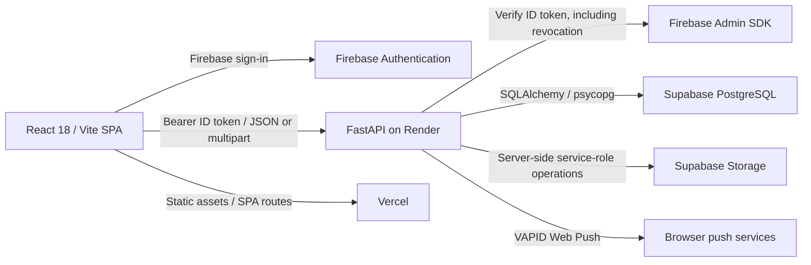
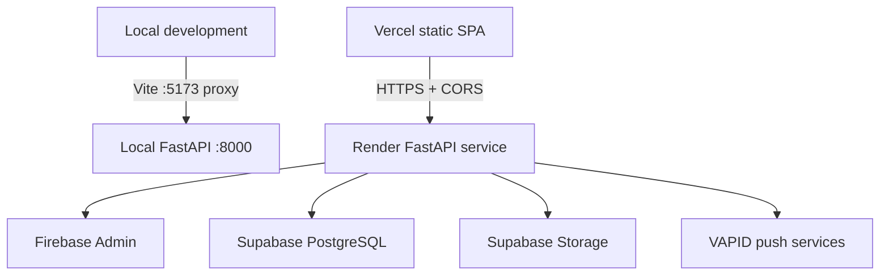

# Architecture

## System overview

The active system is a browser SPA and a separate FastAPI service. Firebase authenticates the user; the API verifies the resulting ID token and derives authorization from the user row in PostgreSQL. Supabase is used for PostgreSQL hosting and Storage; the frontend does not use a Supabase SDK.



The root `main.py` is an ASGI compatibility wrapper. Render's configured service is rooted at `backend/` and runs the FastAPI application. See [PROJECT_MAP.md](PROJECT_MAP.md) for file ownership.

## Frontend architecture

- `frontend2/main.jsx` bootstraps the SPA. `App.jsx` defines React Router routes, lazy-loads pages, and composes authentication, toast, cookie-consent, and error-boundary providers.
- `AuthContext.jsx` owns Firebase sign-in/session behavior, ID-token refresh, `/auth/sync`, profile state, and reauthentication/MFA flows. `ProtectedRoute.jsx` controls presentation/navigation only; it is not a security boundary.
- `client.js` is the shared HTTP client. It adds the in-memory bearer token, handles JSON and multipart requests, applies request/upload timeouts, retries eligible GET network failures, and signals session expiry on authenticated 401 responses.
- `endpoints.js` centralizes endpoint strings. Feature pages and helpers call the shared client instead of building independent auth/request stacks.
- `PortalLayout.jsx`, `Sidebar.jsx`, and `Topbar.jsx` provide the authenticated shell. Feature pages own view state; domain panels/components are reused under feature pages.
- Academic files are previewed locally where a supported renderer exists; access to private file content is obtained through authenticated API preview/download routes and short-lived links. Unsupported formats remain download-only or unsupported.
- The Vite development server proxies API requests to the local backend. Vercel rewrites SPA paths to `index.html` and sets response security headers.

## Backend architecture

- `app.main:app` creates the FastAPI app, configures CORS, mounts domain routers, and defines the health route and generic exception handler.
- Routers validate requests with Pydantic schemas, resolve the SQLAlchemy session through `get_db`, and apply security dependencies. Domain operations may use services under `app/services/`.
- Firebase Admin verifies ID tokens, including revocation; `get_current_user` maps the verified Firebase UID to the application `users` row. Admin and Super Admin dependencies enforce database roles. Role approval additionally checks a recent Firebase second-factor claim.
- SQLAlchemy is the persistence layer. Alembic owns schema changes; `backend/alembic/env.py` imports domain models to populate metadata. Production tables are not created with `metadata.create_all()`.
- `storage.py` uses server-side Supabase credentials. Directory media is served from the configured directory-media bucket; academic resources use a private bucket with API streaming and short-lived signed URLs.
- Notification publishing/delivery, privacy workflows, resource indexing/streaming, role-management, and mentorship matching have domain-specific services or transaction logic. Follow the feature router into its service rather than duplicating it.

## Database and authorization

The API connects to PostgreSQL using its trusted server-side database identity. Some backend-only tables enable RLS and revoke direct `PUBLIC`, `anon`, and `authenticated` grants; the browser is not given database credentials. RLS coverage is table-specific; see [DATABASE_SCHEMA.md](DATABASE_SCHEMA.md).

The database role is the authorization source of truth:

- `student`: normal authenticated portal access and narrowly allowlisted own-profile updates.
- `admin`: administrative content and directory operations and role-change requests.
- `super_admin`: normal admin access plus role-change approvals, with recent Firebase MFA.

Ownership is derived from the verified profile in the backend, not accepted from user-controlled request payloads. Mentorship records and privacy requests are scoped to their owners/participants; shared academic resources are not treated as personal records.

## API communication and data flows

```mermaid
sequenceDiagram
  participant U as User
  participant UI as React client
  participant FA as Firebase Auth
  participant API as FastAPI
  participant DB as PostgreSQL
  U->>UI: Sign in
  UI->>FA: Email/password or Google; optional MFA step
  FA-->>UI: Firebase ID token
  UI->>API: POST /auth/sync with bearer token
  API->>FA: Verify token and revocation
  API->>DB: Resolve/create profile by verified Firebase UID
  DB-->>API: Profile and database role
  API-->>UI: User profile
  UI->>API: Feature request with bearer token
  API->>FA: Verify token
  API->>DB: Apply ownership/role checks and read/write data
  API-->>UI: JSON, stream, or short-lived signed URL
```

The API surface has both legacy top-level prefixes (`/auth`, `/users`, `/admin`, `/announcements`, `/privacy`) and feature prefixes under `/api/`. The frontend endpoint constants and Vite proxy define which paths the client calls. Privacy currently has both `/privacy` and `/api/privacy` route families; do not assume their statuses, response shapes, or workflows are identical. The verified routes are listed in [API_REFERENCE.md](API_REFERENCE.md).

## External integrations

| Integration | Use |
|---|---|
| Firebase Authentication | Email/password and Google sign-in, email verification, password reset, ID tokens, and MFA. |
| Firebase Admin SDK | Backend token verification/revocation and identity claims. |
| Supabase PostgreSQL | Relational application data, accessed through SQLAlchemy/psycopg. |
| Supabase Storage | Server-side directory image handling and private academic-resource storage/links. |
| VAPID/browser Push API | Optional device notifications; in-app notifications remain persisted in the application database. |
| Render | FastAPI hosting and backend environment configuration. |
| Vercel | Static frontend hosting, SPA rewrite, and browser security headers. |
| Google Fonts | Font delivery referenced by the frontend. |

## Deployment shape



Local setup, required environment-variable names, and deployment steps are in `README.md`, `render.yaml`, `frontend2/vercel.json`, and the environment examples. Never put backend credentials in frontend `VITE_*` variables. Deployment domain alignment and live migrations are operational facts that must be checked in the target environment; source configuration alone cannot verify them.
